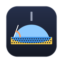

#  LibreDrop

Open contact-angle and drop-shape analysis for backlit side views (developed for an Ossila contact angle
goniometer). The main application is the wetting of battery separators by water, organic carbonates and
electrolytes: porous, absorbing samples where the drop spreads and soaks in, so dynamic analysis from video
comes first.

**Status: early development.** The analysis core works on synthetic drops of known angle and on the first real
frames from an Ossila goniometer (water on glass and tape, 17–88°). No graphical program or video analysis yet.

- Contact angle by Young–Laplace fit (with gravity; also gives the Bond number), tangent (left and right
  separately), circle, ellipse and height–width methods.
- Baseline from a dark substrate at the image sides, or, on a bright glass/film surface, from the corners where
  the drop meets its reflection.
- Checks on every image: backlight, focus, stage tilt, flat sample, needle in the drop, drop at the image edge,
  resolution, gravity flattening, low angles.
- `LibreDropCLI analyze IMAGE` prints all methods and checks; `LibreDropCLI synth` makes test drops.

Planned: video analysis (angle, base width, height and volume vs time from first contact; absorption and
spreading rates), camera control, pendant-drop surface tension, surface free energy for non-absorbing samples.

Build: C++17, Qt 6 (Core, Gui), Eigen 3.4+, CMake 3.21+.

    cmake -S . -B build && cmake --build build && ctest --test-dir build

MIT licence.
