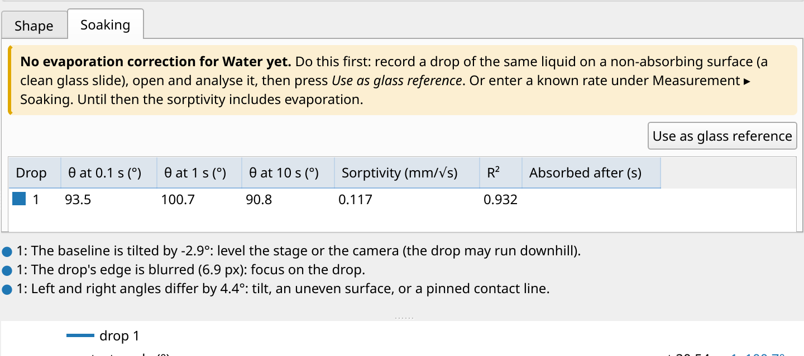
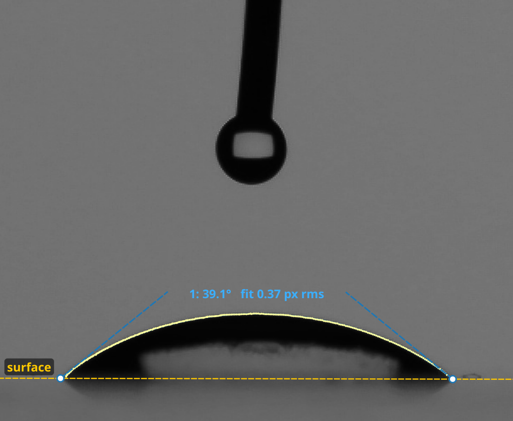
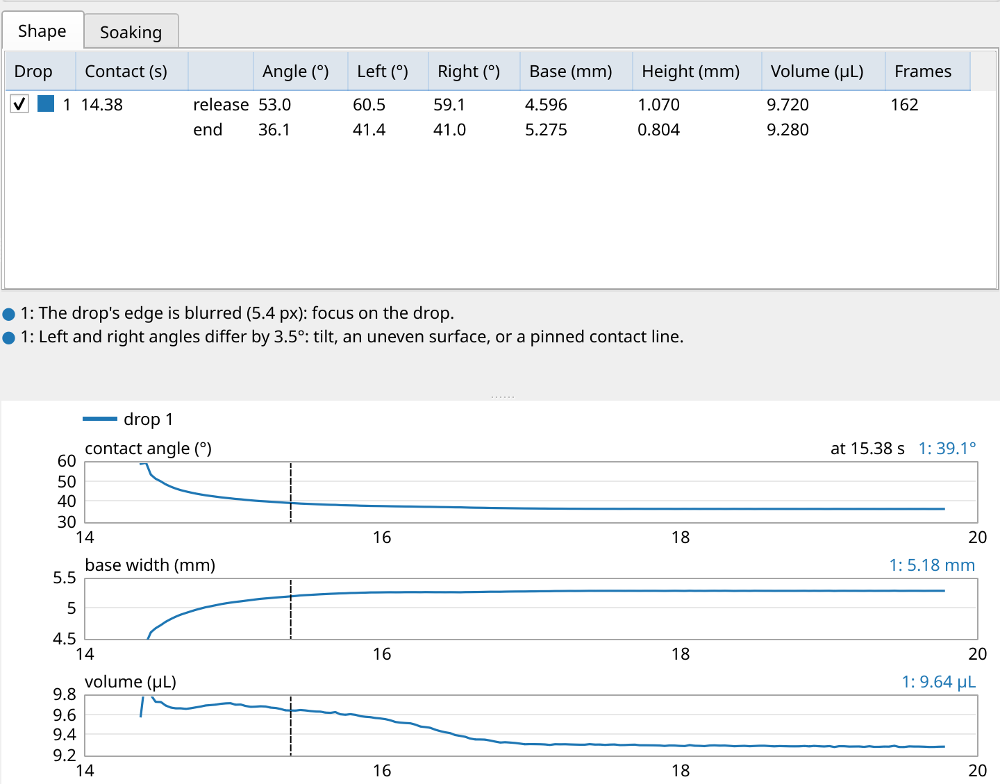
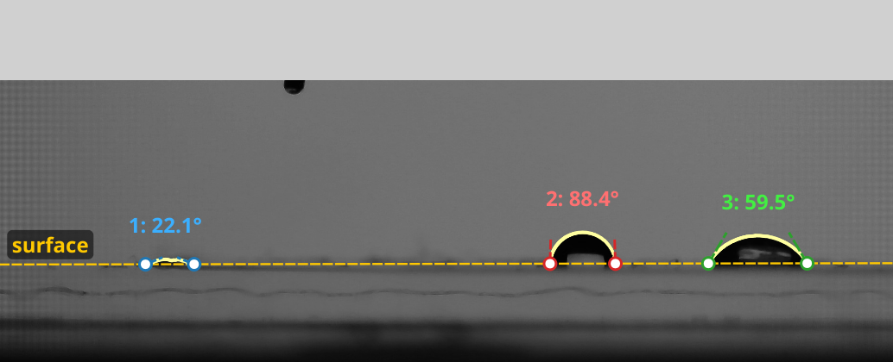
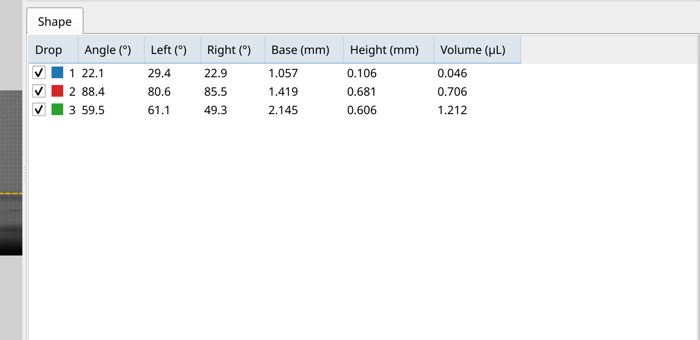
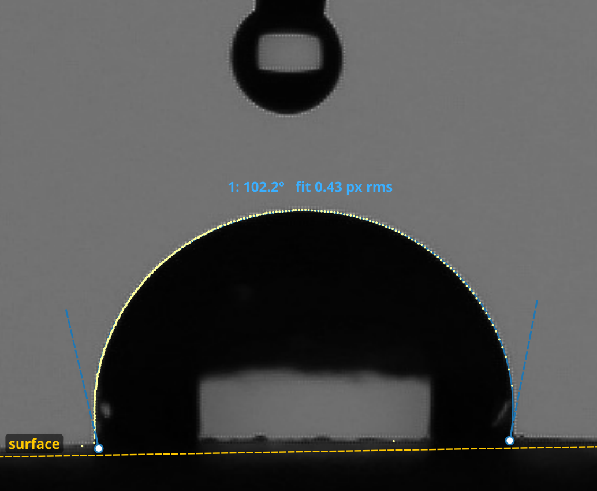
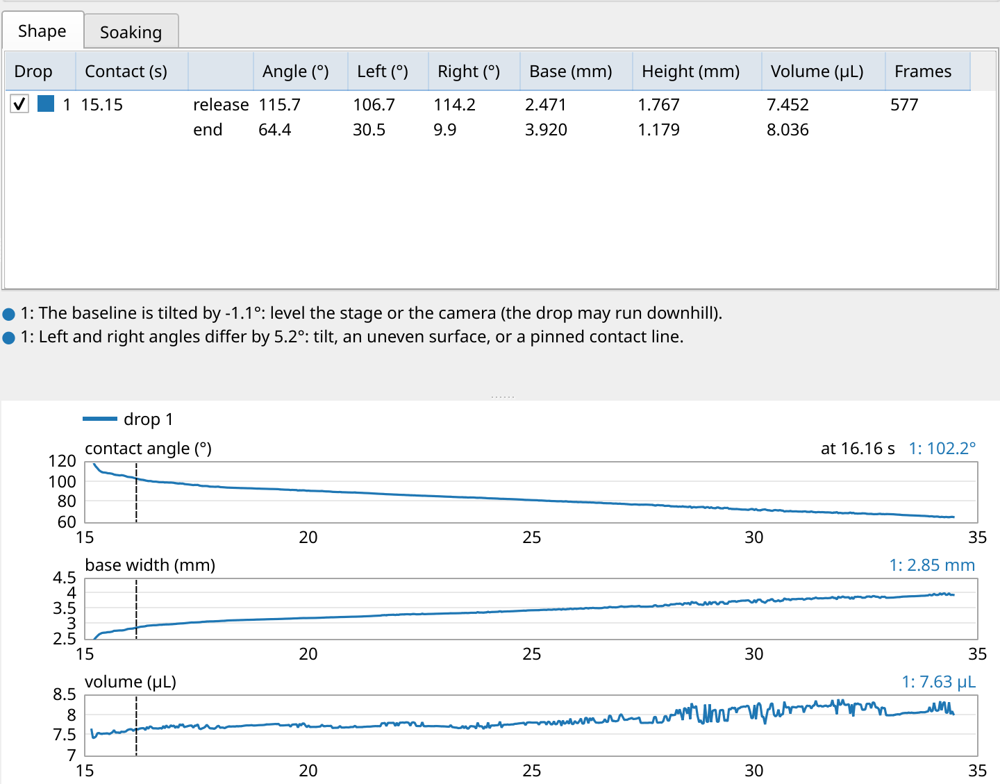
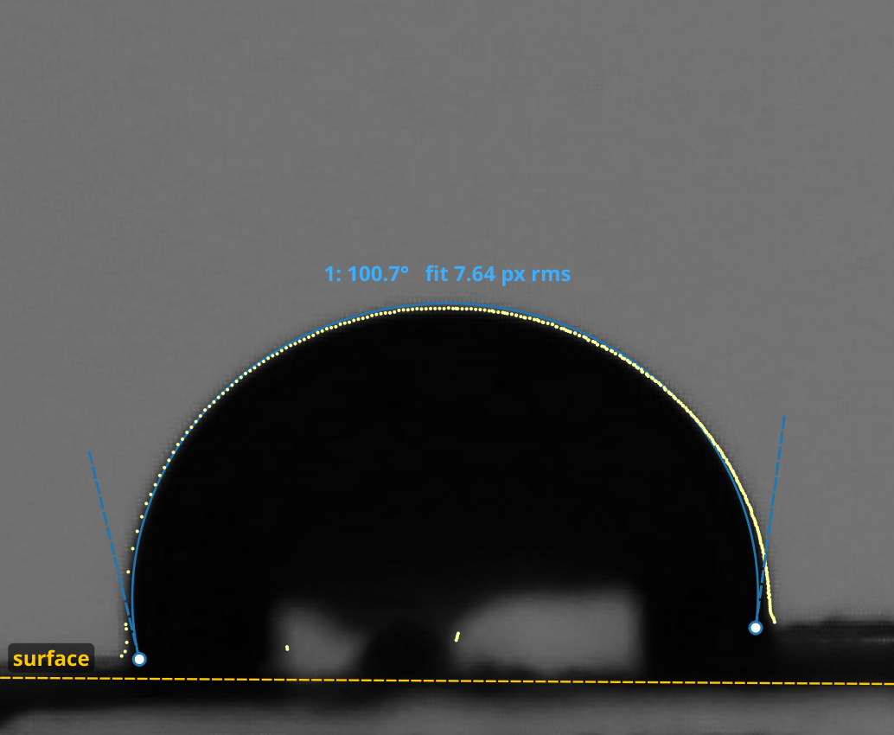
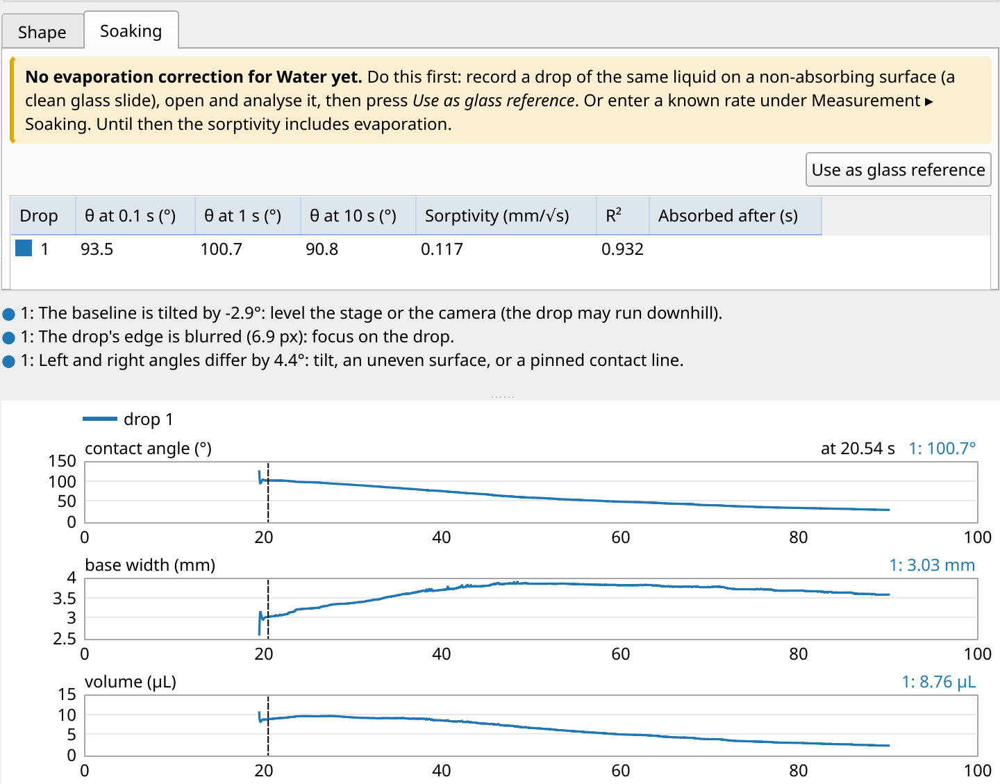
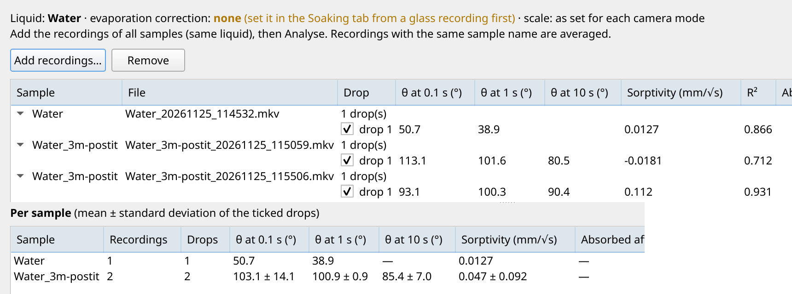

# LibreDrop user manual

LibreDrop measures contact angles and drop shapes from a backlit side view of a drop, as seen by the lab's Ossila
contact angle goniometer. It records the drop from the camera and finds the surface and every drop by itself, in
every frame of the video. It was written for battery separators (paper, pulp, nylon), where the drop spreads and
soaks in, so it works with videos rather than single pictures.

What you get for each drop: the contact angle (left, right and a fit of the whole outline), base width, height and
volume against time, and for soaking samples the angle at fixed times, the sorptivity and when the drop was
absorbed.

## 1. Installing

Download the installer for your computer from the releases page:
<https://github.com/ohlincha/libredrop/releases>

- **Debian / Ubuntu**: download the `.deb` file, then in a terminal in the download folder:
  `sudo apt install ./libredrop_…deb` (the full file name, e.g. `libredrop_0.2.9_amd64.deb`).
- **Windows**: run the `.exe` installer. **macOS**: open the `.dmg` and drag LibreDrop to Applications.

The **live camera works on Linux only** so far. On Windows and macOS you can open and analyse recordings, and
practise with the simulator (section 9). Recordings from the goniometer camera open directly; other video formats
need ffmpeg (Linux: `sudo apt install ffmpeg`).

## 2. First start and the main window

Start **LibreDrop** from the applications menu. To try it without the instrument, choose
**Help ▸ Open example (water on glass)**: a short recording of a water drop on glass opens and is analysed.

| Part | What it is |
|---|---|
| **Image** (left) | The frame shown, with the surface (dashed line), each drop's outline, contact points, tangents and angle. Wheel: zoom; drag: move; click a drop: zoom to it; double-click: whole frame. |
| **Play bar** (bottom left) | Play/pause (Space), speed, and the slider to step through the video. |
| **Measurement** (top right) | Scale (px/mm), liquid, which frames to measure, soaking times and evaporation. **Measure…** opens the camera, **Analyse** measures the open recording again. |
| **Shape / Soaking tabs** | The table of drops (section 4) and the soaking results (section 5). |
| **Checks** (below the table) | Warnings about the image: focus, tilt, drop too small, needle in the drop, … |
| **Plot** (bottom right) | Angle, base width and volume against time. Click it to jump to that time. |
| **Status bar** | What the analysis found, or what went wrong. |

The menus: **File** (measure, open, export, compare samples), **Project** (a folder for a study, section 8) and
**Help** (this manual, the example, a short guide to separators).

## 3. Measuring with the camera

Open **File ▸ Measure with the camera…** (Ctrl+M), or press **Measure…** in the main window.

1. **Camera.** Choose the goniometer camera in the *Camera* list (press *Look again* if you plugged it in after
   opening the window). *Size and rate*: 640 × 480 (the camera says 120 fps; it delivers about 99) for liquids that soak in within a second or two,
   otherwise the larger size. The goniometer camera gets Ossila's settings; exposure 3.9 ms is right with the
   backlight on. If the image is too dark, raise the *Exposure*; the window warns about a black or white image.
2. **Scale.** Enter the needle's **outer diameter** under *Needle Ø* (once; the lab's needle is **0.4745 mm**).
   LibreDrop measures the needle's width in the live image whenever it comes down from the top edge and shows
   the scale it gives (*Scale: … px/mm from the needle*); it is stored with each recording. When you open a
   recording, the scale is measured from its needle again. Set *Needle Ø* to 0 to type a scale by hand instead.
3. **Find drops in the live image** (tick box): shows the surface, the outline and the angle while you set up.
   Useful to check the focus and the stage before the drop goes on.
4. **Sample details, before recording.** Fill in *Sample* (e.g. kraft-A), *Side*, *Direction* (MD or CD for paper),
   *Liquid* and *Volume*; tick *Control or reference sample* for glass or PTFE. Add a *Note* if useful.
5. **File name.** Leave it empty: the name is made from liquid, sample, side and direction, and the date and time
   are added when you press Record (the grey line below shows it, e.g. `Water_kraft-A_front_MD_20261125_101500.mkv`).
   Type your own name only if you need to.
6. **Record.** Bring the drop down and press **Record** (Ctrl+R) as it touches the surface. The video **always
   starts 2 s before you press Record**, so the moment of contact is in it even if you press late.
7. **Stop.** Press **Stop** when the drop has settled or soaked in. Or set *Stop* to a number of seconds before
   recording, and it stops by itself.

**Where the files go.** With a project open: into the project's `recordings/` folder, filed under the sample.
Without a project: into `Documents/LibreDrop` in your home folder, or the folder chosen with *Folder…*; *Open*
shows it in the file manager. Each recording is a `.mkv` video with a `.json` file next to it holding the sample
details. Keep both. With *Open and analyse when stopped* ticked, the recording opens in the main window and is
analysed straight away.

## 4. Analysing a recording

1. **Open** it: *File ▸ Open video or image…* (Ctrl+O), or drag the file onto the window. Images (PNG, JPEG, TIFF)
   work too. The analysis starts by itself; the status bar shows its progress. *Analyse* runs it again (for
   example after changing the scale or the liquid); while it runs, the button reads *Cancel*.
2. **Check the scale and liquid** in *Measurement*. The liquid (water, DMC, DEC, PC or custom) sets density and
   surface tension for the shape fit. *Frames*: "all", or 1 in n to make long videos faster.
3. **Read the table** (*Shape* tab). One line per drop, with the time it touched the surface (*Contact*), then two
   rows:
   - **release**: just after the needle has left the drop (median of the first 5 frames after);
   - **end**: at the end of the recording (median of the last 5 frames).
   *Angle* is the Young–Laplace fit of the whole outline: **the contact angle to use**. *Left* and *Right* are the
   tangents at each contact point, as a check. A drop marked *on needle* never came free of the needle.
   Hover over the end row for the rates of change.
4. **Look at the plot and the images.** Step through the video with the slider or play it; click the plot to jump
   to a time. Check that the outline follows the drop and the surface line is on the surface. Tick
   *Time from each drop's contact* to put t = 0 at each drop's touch.
5. **Tick the drops that count.** Untick anything that is not a real drop on the sample (dust, a drop dragged by
   the needle). Only ticked drops are plotted and exported.
6. **Export**: *File ▸ Export table (CSV)…* writes every frame's values for the ticked drops (opens in a
   spreadsheet); *File ▸ Export plot (PNG)…* saves the plot.

*File ▸ Save compact copy…* makes a much smaller copy of a recording (the band around the drops, in grey), handy
for keeping or sending.

## 5. Soaking measurements on separators

For porous samples where the drop soaks in. Work in this order.

**Before you start**

1. **Scale**: *Needle Ø* set to the needle's outer diameter (the lab's needle: 0.4745 mm); LibreDrop measures
   the needle in every recording.
2. **Liquid**: choose it in the main window; the same bottle for the whole series. Note the room temperature and
   humidity (LibreDrop stores them with each recording if a USB sensor is plugged in).
3. **Sample**: cut a strip and mount it **flat**, for example taped to a glass slide at its ends, with a **straight,
   clean edge towards the camera**; the drop goes on near that edge. A curled or frayed edge makes the surface
   harder to find (see the post-it in section 7). Fill in sample, side and direction in the Measure window.

**Glass first**, once per liquid and day: record a drop of the same liquid on a clean glass slide, for about as
long as you will record the samples. Open it, let it analyse, then go to the **Soaking** tab and press
**Use as glass reference**. This measures how fast the liquid evaporates, so that evaporation is not counted as
soaking. It is kept for that liquid. The Soaking tab tells you (in amber) when this is missing.

**One drop at a time**

1. Dispense the **same volume** every time (for example 2–5 µL; note it in *Volume*). Let it hang from the needle.
2. Lower the needle until the drop touches the sample, then lift it straight away; the needle must not touch the
   sample. Press **Record** as the drop touches; the video starts 2 s earlier, so a late press is fine.
3. Record until the drop has soaked in, or for a fixed time (for example 60 s; *Stop* after that time).
   Use 640 × 480 (about 99 fps) when the liquid soaks in within a second or two, 1920 × 1080 otherwise.
4. Put the next drop on a **fresh spot** (at least 5 mm from the wet area) or a new piece. Measure **3 drops or
   more** per sample, on both sides and both directions (MD and CD) if they may differ.

**Does a drop count?** Open the recording and check: the outline follows the drop and the surface line lies on
the sample; the drop is not marked *on needle*; the Young–Laplace fit residual (*fit … px rms* in the image) is
small (below about 1 px for a clean edge); for the sorptivity, R² ≥ 0.9. Untick drops that fail and say so.

4. **Read the Soaking tab** for each recording:

| Column | Meaning |
|---|---|
| **θ at 0.1 s, 1 s, 10 s** | Contact angle at these times after contact. Change the times under *Measurement ▸ Soaking*. "—" means the drop was still on the needle then, or already gone. |
| **Sorptivity** (mm/√s) | How fast the sample takes up liquid: absorbed volume = S · contact area · √t. On glass it should come out about 0. |
| **R²** | How well the drop follows that law (1 = exactly). Low values: treat S with care. |
| **Absorbed after** (s) | Time from contact until the drop disappeared; empty if it was still there at the end. |

The sorptivity depends on the scale: compare only samples measured at the same scale (camera size).

## 6. Reporting results

**What to report** for each sample:

| Item | Where it comes from |
|---|---|
| Sample (material, batch, side, direction) and liquid (supplier, batch) | your notes; the Measure window's fields |
| Drop volume, temperature, relative humidity | *Volume*; the status bar / the recording's `.json` |
| Scale and how it was set (needle diameter), camera size and frame rate | *Measurement*; Measure window |
| Number of drops n (and of sample pieces) | the ticked drops |
| Contact angle at fixed times after contact, mean ± SD | Soaking tab (*θ at …*), or Compare samples |
| Sorptivity S, mean ± SD, and its R² | Soaking tab, or Compare samples |
| Absorption time | Soaking tab (*Absorbed after*) |
| Evaporation correction used | Soaking tab (it names the glass reference used) |
| Method | e.g. "contact angles from Young–Laplace fits to the whole drop outline (LibreDrop); sorptivity from V(t) = V₀ − S ∫ A d√t, corrected for evaporation" |

**Getting the numbers out.** Put all recordings of a study in *Compare samples* (or a project), tick the drops
that count, **Analyse**, then **Export CSV…**: one row per drop, then a *sample_mean* and a *sample_sd* row per
sample; paste these into your table. For figures, *File ▸ Export plot (PNG)…* saves the angle, base width and
volume against time, or plot the per-frame CSV (*Export table*) in Origin, Excel or Python.

**Worked example** (one drop of water on a 3M post-it, recorded without special care, see section 7):

| | Value |
|---|---|
| θ at 1 s / 10 s after contact | 101° / 91° |
| Sorptivity S | 0.117 mm/√s (R² 0.93) |
| Volume above the paper | about 9 µL at contact, about 2.5 µL after 70 s |
| Absorption time | > 70 s (still there at the end of the recording) |
| n | 1 drop (a report needs 3 or more) |
| Scale | from the needle (0.4745 mm), about 90 px/mm |
| Temperature, RH | not recorded (made before LibreDrop stored them) |
| Evaporation correction | none (no glass reference that day) |

The angle at 0.1 s (94°) is left out: the drop still wobbles just after landing, which the fit residual shows. A
proper report would give mean ± SD of three or more drops on fresh spots, with the glass reference applied.

## 7. Real examples (recorded without special care)

These are recordings from the lab's goniometer, made quickly and without any preparation: no cleaning, no
levelling, the sample just put on the stage. LibreDrop found the surface and the drops by itself in every frame,
and the scale from the needle (about 90 px/mm).

**Water on a glass slide.** The drop lands at 14.4 s and spreads: 53° at release, 36° after five seconds; the base
grows from 4.6 to 5.3 mm. The surface is found from the drop's reflection in the glass.

**Water on Scotch tape** (a single picture with three drops): 88° and 60° for the two drops, each measured on
its own; the small one on the left is flagged as too small for an accurate angle.

**Water on a 3M post-it** (paper: opaque, curled, with a raised fibrous ridge and a lifted edge — about the
worst sample there is). There is no reflection, so the surface is the paper's own edge, and each drop gets its own
baseline next to it. On the first drop the angle falls from 116° to 64° within 20 s as the paper takes the water
up, and the base widens from 2.5 to 3.9 mm (the tangents, *Left* and *Right*, are unreliable on this frayed edge;
use *Angle*):

A second drop, recorded for 90 s, soaks in: the angle falls from 113° to about 30°, the base first spreads and
then stays put, and the volume above the paper falls from about 9 to about 2.5 µL. The Soaking tab gives the angle
at 0.1, 1 and 10 s after contact (94°, 101°, 91°) and the sorptivity, 0.117 mm/√s (R² 0.93).

## 8. Projects and comparing samples

**Projects** keep a study together. *Project ▸ New project…* makes a folder with the recordings, sample list,
liquids, scales and glass references. The **Library** panel then lists samples and recordings: double-click a
recording to open it; *Add…* files existing recordings. Opening a recording from a project sets its liquid, scale
and that day's evaporation correction for you. Back up or share a project by copying its folder. One user at a
time.

**Compare samples** (*File ▸ Compare samples…*, or *Compare* in the Library): add the recordings of all samples
(same liquid) and press **Analyse**. Recordings with the same sample name are averaged (mean ± standard deviation
of the ticked drops). The sample name comes from the file name without date, time and repeat number;
double-click it to change it. *Export CSV…* writes every drop and the per-sample means.

## 9. Practising with the simulator

No instrument needed. In the Measure window, pick a camera whose name starts with **Simulator:**, for example
*Simulator: Flat separator, soaking* or *Simulator: Water on glass (reflection)*. A needle brings a drop down, it
touches, spreads and (on separators) soaks in, again and again. Everything works as with the real camera: set the
scale from the needle, fill in the sample, Record and Stop, then analyse.

The simulator draws every frame, which is slow on a busy computer. Choose the **half size** in *Size and rate*
(960 × 540) to keep up with 30 fps.

## 10. Tips for good images

- **Backlight on, lens cap off.** The drop must be a dark shape on a bright background.
- **Focus on the drop.** A soft edge gives a warning ("The drop's edge is blurred") and less accurate angles.
- **Level the stage.** The checks report a tilted baseline.
- **Separators: mount them flat**, e.g. taped on a glass slide, with a **clean, straight cut edge towards the
  camera**. Frayed fibres, waves or a lifted edge make the surface line hard to find.
- **Leave space**: the drop must not touch the image edge, and should be well over 150 px wide (zoom in or use a
  larger drop).
- **Withdraw the needle** after the drop is placed; the needle in the drop spoils the angle.
- Record for as long on glass as on the samples, and record the glass reference on the same day.

## 11. Troubleshooting

| Problem | What to do |
|---|---|
| The live image is **black** | Backlight on? Lens cap off? Otherwise raise the exposure. A **white** image: lower it. |
| **No camera found** | Plug the camera in and press *Look again*. Live camera: Linux only for now. |
| The camera runs slower than its rate | The exposure is longer than one frame: shorten it. The real frame times are recorded, so results are not affected. |
| **"no drop on a surface"** / **"surface not found"** | The surface must be visible as a straight edge across the image (or, on glass, the drop's reflection). Check backlight and focus; mount the sample flat with a straight edge. |
| Angle looks wrong | Step to the frame and look: does the outline follow the drop, is the dashed line on the surface? Read the checks below the table. Untick drops that are not real. |
| Sizes in px, no volume | Enter *Needle Ø* (0.4745 mm for the lab's needle) with the needle in view, or type the scale. |
| **"No needle found"** when setting the scale | The needle must come down from the top edge of the image; move to a frame where it does. |
| Soaking tab: **no evaporation correction** | Record and analyse a drop on glass, then *Use as glass reference* (section 5). |
| The table or plot is cut off | Drag the divider between the image and the right-hand panel (or between table and plot) to make it wider. |
| A video does not open | Recordings from LibreDrop always open; other formats need ffmpeg installed. |
| Analysis of a long video is slow | Set *Frames* to 1 in 2 or more, and press *Analyse*. |

LibreDrop is free and open source (MIT licence): <https://github.com/ohlincha/libredrop>. Report problems there.
